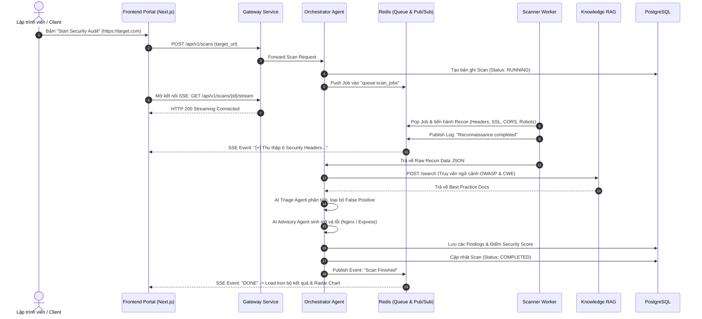

# THIẾT KẾ KIẾN TRÚC MICROSERVICES (MICROSERVICES ARCHITECTURE SPECIFICATION)

> **Dự án:** AegisOps-AI  
> **Kiến trúc:** Event-Driven Microservices + Agentic Orchestration Layer

---

## 1. Sơ đồ Phân rã Dịch vụ (Service Decomposition)

Hệ thống được chia thành 5 Microservices độc lập và 2 hạ tầng hỗ trợ (Data Stores):

```
                                  [ INTERNET ]
                                       │
                                       ▼ (Port 80/443)
                         [ Ingress Nginx / API Gateway ]
                                       │
     ┌─────────────────────────────────┼─────────────────────────────────┐
     │ (Port 3000)                     │ (Port 8000)                     │ (Port 8001)
     ▼                                 ▼                                 ▼
[ frontend-service ]          [ gateway-service ]               [ auth-service ]
Next.js 14 / TypeScript       FastAPI Proxy / Rate Limit        Go / Python FastAPI
Dashboard & SSE Client        Router & Request Validator        JWT & User Management
                                       │
                                       ▼ (Internal REST / gRPC)
                            [ orchestrator-service ] (Port 8002)
                              FastAPI + LangGraph Engine
                              Multi-Agent State Machine
                                       │
               ┌───────────────────────┴───────────────────────┐
               ▼ (Job Queue via Redis)                         ▼ (Internal HTTP)
     [ scanner-worker-service ]                      [ knowledge-rag-service ] (Port 8003)
     Python Worker + Async HTTP                       FastAPI + ChromaDB / Qdrant
     Docker Sandboxed Tools                           OWASP WSTG & CWE Embeddings
```

---

## 2. Chi tiết Từng Dịch vụ (Service Specifications)

### 2.1. `frontend-service` (Web Portal)
- **Công nghệ:** Next.js 14 (App Router), React 18, TypeScript, TailwindCSS, Shadcn/UI, Lucide Icons, Recharts.
- **Cổng nội bộ:** `3000`
- **Trách nhiệm chính:**
  - Cung cấp giao diện đăng ký, đăng nhập và bảng điều khiển quản lý các mục tiêu quét.
  - Kết nối Server-Sent Events (SSE) để hiển thị trực tiếp dòng suy nghĩ và log hoạt động của AI Agent theo thời gian thực.
  - Hiển thị Radar Chart phân loại 10 hạng mục rủi ro của OWASP và danh sách chi tiết các phát hiện (Findings).
  - Cung cấp khung chat tương tác với SecOps Copilot để lập trình viên hỏi đáp và copy code vá lỗi.

### 2.2. `gateway-service` (API Gateway & Ingress Dispatcher)
- **Công nghệ:** Python 3.12 (FastAPI) hoặc Nginx Reverse Proxy.
- **Cổng nội bộ:** `8000`
- **Trách nhiệm chính:**
  - Điểm tiếp nhận duy nhất cho mọi HTTP request từ Frontend.
  - Xác thực chữ ký JWT Token (gọi xác thực nhanh hoặc verify public key).
  - Rate Limiting (giới hạn số lần quét cho mỗi tài khoản để chống spam).
  - Định tuyến (Routing):
    - `/api/v1/auth/*` ➔ `auth-service`
    - `/api/v1/scans/*` ➔ `orchestrator-service`
    - `/api/v1/copilot/*` ➔ `knowledge-rag-service`

### 2.3. `auth-service` (Authentication & Authorization)
- **Công nghệ:** Python 3.12 (FastAPI + SQLAlchemy) hoặc Go (Gin).
- **Cổng nội bộ:** `8001`
- **Cơ sở dữ liệu:** PostgreSQL (bảng `users`, `organizations`).
- **Trách nhiệm chính:**
  - Đăng ký, đăng nhập, cấp phát Access Token (JWT hết hạn sau 2 giờ) và Refresh Token (7 ngày).
  - Quản lý phân quyền người dùng (Role-Based Access Control: `ADMIN`, `AUDITOR`, `VIEWER`).

### 2.4. `orchestrator-service` (AI Agent Orchestration Core)
- **Công nghệ:** Python 3.12, FastAPI, LangGraph / StateGraph, Pydantic v2, Eager Tool Dispatcher, LiteLLM / Gemini SDK / VLLM Client.
- **Cổng nội bộ:** `8002`
- **Mô hình AI:** Hybrid LLM Router:
  - Tầng suy luận quy mô lớn: Gemini 2.5 Flash / Claude 3.5 Sonnet.
  - Tầng chuyên biệt mã vá lỗi & thẩm định an ninh: `SecOps-Llama-3.1-8B-Instruct` (Fine-tuned bằng QLoRA & DPO).
- **Trách nhiệm chính:**
  - Tiếp nhận lệnh quét từ API Gateway hoặc Webhook GitHub Actions.
  - Điều phối vòng lặp ReAct của 3 Sub-Agents:
    1. **Recon Agent:** Giao việc cho `scanner-worker-service` thu thập headers, SSL, robots.
    2. **Triage Agent:** Nhận kết quả thô, gọi `knowledge-rag-service` để đối chiếu CWE/OWASP, đánh giá severity và lọc false-positive.
    3. **Advisory Agent:** Tạo kịch bản vá lỗi, cấu hình Hardening và tự động xuất Git Patch.
  - Xuất stream tiến trình ra Redis Pub/Sub kênh `scan:{scan_id}:logs` để Gateway đẩy về SSE client.

### 2.5. `scanner-worker-service` (Safe Reconnaissance Worker)
- **Công nghệ:** Python 3.12 (Httpx, SSL, Cryptography, DNS-Python), Celery hoặc ARQ (Async Redis Queue).
- **Trách nhiệm chính:**
  - Lấy job từ Redis Queue `queue:scan_jobs`.
  - Thực thi các thao tác trinh sát an toàn:
    - Audit Security Headers & CORS origin reflection.
    - Phân tích chứng chỉ TLS X.509, Cipher Suites.
    - Đọc `robots.txt`, `sitemap.xml`, phát hiện lộ file nhạy cảm.
    - Fingerprint Web Server & WAF qua response headers và cookies.
  - Ghi trả kết quả thô (Raw Findings JSON) về Redis và PostgreSQL.

### 2.6. `knowledge-rag-service` (OWASP & CWE Vector Knowledge Base)
- **Công nghệ:** Python 3.12, FastAPI, ChromaDB (Local Embedded Vector DB - không tốn tiền) hoặc Qdrant.
- **Embedding Model:** `all-MiniLM-L6-v2` (chạy local trên CPU, zero cost) hoặc `text-embedding-004`.
- **Cổng nội bộ:** `8003`
- **Trách nhiệm chính:**
  - Lưu trữ tài liệu chuẩn: OWASP Web Security Testing Guide (WSTG v4.2), MITRE CWE Top 25, và các quy chuẩn DevSecOps Hardening.
  - Cung cấp API Semantic Search: `POST /api/v1/knowledge/search` nhận truy vấn (vd: *"CORS allow origin reflection credentials true"*) ➔ trả về đoạn tài liệu hướng dẫn khắc phục và kịch bản tấn công liên quan.

---

## 3. Thiết kế Cơ sở Dữ liệu (Database Schema - PostgreSQL)

```sql
-- 1. Bảng Quản lý Người dùng
CREATE TABLE users (
    id UUID PRIMARY KEY DEFAULT gen_random_uuid(),
    email VARCHAR(255) UNIQUE NOT NULL,
    hashed_password VARCHAR(255) NOT NULL,
    full_name VARCHAR(100),
    role VARCHAR(50) DEFAULT 'AUDITOR',
    created_at TIMESTAMP WITH TIME ZONE DEFAULT CURRENT_TIMESTAMP
);

-- 2. Bảng Quản lý Mục tiêu Quét (Scan Targets)
CREATE TABLE scan_targets (
    id UUID PRIMARY KEY DEFAULT gen_random_uuid(),
    user_id UUID REFERENCES users(id) ON DELETE CASCADE,
    target_url VARCHAR(500) NOT NULL,
    organization_name VARCHAR(255),
    verified_ownership BOOLEAN DEFAULT FALSE,
    created_at TIMESTAMP WITH TIME ZONE DEFAULT CURRENT_TIMESTAMP
);

-- 3. Bảng Phiên Quét (Scans)
CREATE TABLE scans (
    id UUID PRIMARY KEY DEFAULT gen_random_uuid(),
    target_id UUID REFERENCES scan_targets(id) ON DELETE CASCADE,
    scan_depth VARCHAR(50) DEFAULT 'standard', -- passive, standard, deep
    status VARCHAR(50) DEFAULT 'PENDING',      -- PENDING, RUNNING, COMPLETED, FAILED
    security_score INT,                         -- 0 đến 100
    executive_summary TEXT,
    started_at TIMESTAMP WITH TIME ZONE,
    completed_at TIMESTAMP WITH TIME ZONE,
    created_at TIMESTAMP WITH TIME ZONE DEFAULT CURRENT_TIMESTAMP
);

-- 4. Bảng Chi tiết Phát hiện Lỗ hổng (Vulnerability Findings)
CREATE TABLE findings (
    id UUID PRIMARY KEY DEFAULT gen_random_uuid(),
    scan_id UUID REFERENCES scans(id) ON DELETE CASCADE,
    finding_code VARCHAR(100),                  -- vd: SEC-HSTS-01
    title VARCHAR(255) NOT NULL,
    severity VARCHAR(20) NOT NULL,              -- INFO, LOW, MEDIUM, HIGH, CRITICAL
    owasp_category VARCHAR(100) NOT NULL,       -- A05: Security Misconfiguration
    cwe_id VARCHAR(50),                         -- CWE-942
    description TEXT NOT NULL,
    raw_evidence JSONB DEFAULT '{}'::jsonb,
    impact_analysis TEXT,
    remediation_guidance TEXT,
    remediation_code_snippet TEXT,
    is_false_positive BOOLEAN DEFAULT FALSE,
    created_at TIMESTAMP WITH TIME ZONE DEFAULT CURRENT_TIMESTAMP
);

-- Index tối ưu truy vấn
CREATE INDEX idx_scans_target_id ON scans(target_id);
CREATE INDEX idx_findings_scan_id ON findings(scan_id);
CREATE INDEX idx_findings_severity ON findings(severity);
```

---

## 4. Quy trình Xử lý Dữ liệu Thực tế (Scan Lifecycle Event-Flow)


