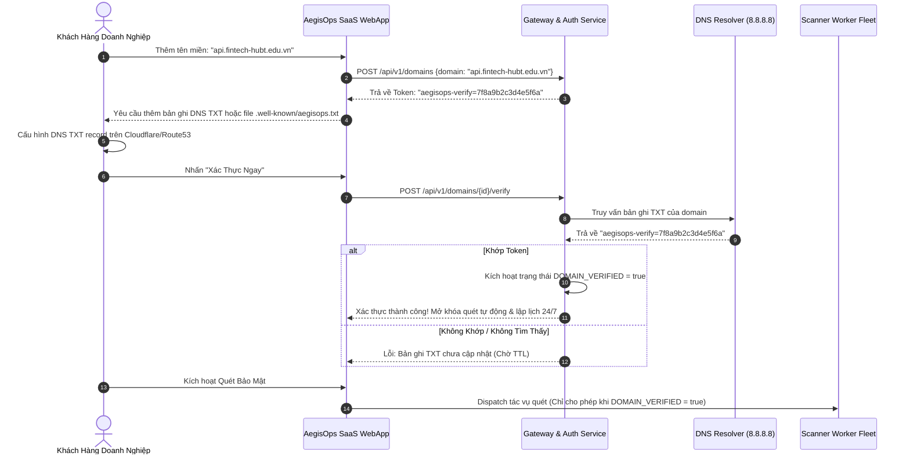

# Kiến Trúc Nền Tảng Thương Mại AegisOps B2B SaaS (Multi-Tenancy & Enterprise Architecture)

## 1. Tầm Nhìn Thương Mại (Commercial B2B SaaS Vision)
AegisOps không chỉ là một công cụ nội bộ hay demo cá nhân, mà là một **Nền tảng B2B DevSecOps & AI Cyber-Security SaaS** thương mại cho phép:
1. **Các công ty công nghệ, Fintech, E-commerce và Software House** đăng ký tài khoản, kết nối hệ thống và tự động đánh giá an ninh mạng định kỳ.
2. **Multi-Tenancy (Đa tổ chức/Đa khách hàng)**: Dữ liệu giữa các công ty được cô lập triệt để ở tầng CSDL (PostgreSQL Row-Level Security hoặc Schema riêng biệt).
3. **Domain Ownership Verification (Bảo vệ pháp lý bắt buộc)**: Người dùng bắt buộc phải chứng minh quyền sở hữu tên miền (qua bản ghi DNS TXT hoặc HTML Meta Tag) trước khi kích hoạt quét tự động, ngăn ngừa tuyệt đối rủi ro pháp lý về tấn công mạng trái phép.
4. **Subscription & Billing Model**: Phân tầng gói cước (Starter Miễn phí, Pro SecOps $49/tháng, Enterprise $299/tháng), giới hạn số lượt quét (Scan Quotas) và số lượng token AI.
5. **Team RBAC (Phân quyền đội ngũ)**: `Owner`, `Security Admin`, `Developer`, `Auditor/Viewer`.
6. **CI/CD Integration**: Cung cấp API Key để tích hợp kiểm tra bảo mật tự động trong GitHub Actions / GitLab CI của khách hàng.

---

## 2. Mô Hình Phân Tầng Gói Cước (Pricing Tiers)

| Tiêu Chí | Starter (Miễn phí) | Pro SecOps ($49 / tháng) | Enterprise Fleet ($299 / tháng) |
| :--- | :--- | :--- | :--- |
| **Đối tượng** | Cá nhân, Dev độc lập, thử nghiệm | Startup, Tech Team (5-20 devs) | Doanh nghiệp, Fintech, E-commerce |
| **Số lượt quét** | 3 lượt quét / tháng | 50 lượt quét / tháng | Không giới hạn |
| **Số tên miền theo dõi** | 1 Domain | 5 Domains (Giám sát 24/7) | Không giới hạn Domains |
| **AI Remediation Code** | Snippets cơ bản (Nginx) | Trọn bộ (Nginx, Express, FastAPI, Next.js) | Tự động tạo GitHub Pull Request (Auto-PR) |
| **Đội ngũ (Members)** | 1 Người | Tối đa 5 Thành viên (RBAC) | Không giới hạn thành viên + SSO / SAML |
| **CI/CD API Keys** | Không hỗ trợ | 2 API Keys | Không giới hạn API Keys |
| **Báo cáo kiểm định** | Tóm tắt trên Web | Xuất PDF & JSON chi tiết | Báo cáo kiểm định có dấu số doanh nghiệp |
| **Hỗ trợ** | Community Discord | Email Support 24/7 (SLA 8h) | Chuyên gia bảo mật kèm 1:1 (SLA 1h) |

---

## 3. Kiến Trúc Bảo Mật & Pháp Lý (Domain Ownership Verification Flow)

Để bán ra thị trường, tính năng quan trọng nhất là **Xác thực quyền sở hữu tên miền**. Nếu bất kỳ ai cũng có thể nhập một URL bất kỳ rồi bấm "Quét", họ có thể dùng hệ thống của anh để trinh sát trái phép các mục tiêu của bên thứ ba, vi phạm Điều 289 Bộ luật Hình sự (xâm nhập trái phép mạng máy tính) và chính sách của nhà cung cấp Cloud (AWS/Hetzner/Google):



---

## 4. Mô Hình CSDL Multi-Tenancy (Data Isolation)

```text
Table: organizations
├── id (UUID, PK)
├── name (VARCHAR: "Fintech Hubt Corp")
├── slug (VARCHAR: "fintech-hubt")
├── subscription_tier (ENUM: "STARTER", "PRO", "ENTERPRISE")
├── subscription_status (ENUM: "ACTIVE", "PAST_DUE", "CANCELED")
├── monthly_scan_quota (INT: 50)
├── scans_used_this_month (INT: 12)
└── created_at (TIMESTAMP)

Table: organization_members
├── id (UUID, PK)
├── org_id (FK -> organizations.id)
├── user_id (FK -> users.id)
├── role (ENUM: "OWNER", "SECURITY_ADMIN", "DEVELOPER", "AUDITOR")
└── joined_at (TIMESTAMP)

Table: domains
├── id (UUID, PK)
├── org_id (FK -> organizations.id)
├── domain_name (VARCHAR: "api.fintech-hubt.edu.vn")
├── verification_token (VARCHAR: "aegisops-verify-...")
├── is_verified (BOOLEAN: TRUE)
├── verified_at (TIMESTAMP)
└── auto_scan_schedule (ENUM: "MANUAL", "DAILY", "WEEKLY")

Table: api_keys
├── id (UUID, PK)
├── org_id (FK -> organizations.id)
├── key_prefix (VARCHAR: "aegis_live_")
├── key_hash (VARCHAR: SHA256)
├── name (VARCHAR: "GitHub Actions CI/CD")
└── last_used_at (TIMESTAMP)
```
